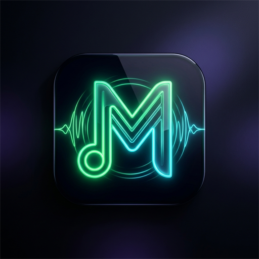

# 🎵 Müzikal

  

> YouTube ve Spotify destekli, modern masaüstü ve Android müzik çalar uygulaması.

---

## ✨ Özellikler

- 🌟 **Yenilenen Spotify Tarzı Ana Sayfa (v1.3.1):** Ana ekrandan karmaşık trend etiketleri kaldırıldı ve menüdeki "Trendler & Keşif" sekmesine taşındı. Ana sayfada artık doğrudan **Son Dinlenenler**, Spotify tarzı dairesel **Önerilen Sanatçılar** (Semicenk, Sezen Aksu, Duman, Lvbel C5, Manga, Mor ve Ötesi, Gülşen, vb. - tek dokunuşla sanatçının şarkılarına ulaşın) ve **Sana Özel Önerilen Parçalar** yer alır.
- 🖼️ **Kristal Netliğinde HD Bildirim & Kilit Ekranı Kumandası (v1.3.1):** Bildirim çubuğu ve kilit ekranındaki düşük çözünürlüklü (144p) albüm kapağı sorunu çözüldü! YouTube küçük resimleri yerine 720p/1080p yüksek çözünürlüklü kapaklar ve yerel `MediaMetadata` kullanıldı. Bildirim kumandasına **Karışık Çal (🔀)** ve **Tekrar Çal (🔁)** butonları eklendi.
- 🎯 **Saf Müzik Odaklı Arama Motoru (v1.3.1):** Arama motoruna eklenen akıllı müzik filtresi sayesinde oyun videoları (gameplay, PUBG, Valorant, Minecraft, GTA, Roblox vb.), vloglar, klip tepki videoları ve 1 saatlik kulüp miksleri arama sonuçlarından filtrelenir; yalnızca aradığınız gerçek müzik parçaları ve klipleri listelenir.
- ⚡ **100% PC Bağımsız Çalışma:** Bilgisayarınız kapalıyken bile telefon uygulaması kesintisiz çalışır. Gömülü yerel motor (`NativeEngine`) sayesinde arama, şarkı sözleri, oynatma ve favoriler doğrudan telefonunuz üzerinden bağımsız olarak yürütülür.
- 🎤 **Spotify Tarzı Canlı Şarkı Sözleri (v1.3.0):** Şarkı çalarken tek tıkla açılan şık koyu cam panelde gerçek zamanlı karaoke şarkı sözleri! Şarkı aktıkça okunan satır parıldayarak beyaz renkte öne çıkar ve ekran otomatik kayar. Dilediğiniz söz satırına dokunarak şarkıyı doğrudan o saniyeye atlatabilirsiniz. (Sözü bulunmayan şarkılarda gereksiz kalabalık yapmaz).
- 🎧 **Android Kusursuz Arka Planda Çalma & Kilit Ekranı Kumandası (v1.3.0):** Uygulama simge durumuna küçültüldüğünde, ekran kilitlendiğinde veya başka uygulamalara geçildiğinde müzik asla kesilmez. Yerel `MediaSession` ve `MediaWebView` mimarisiyle telefonun uyku moduna geçmesi engellenir. Kilit ekranında ve bildirim çubuğunda şarkı kapağı ile Önceki, Oynat/Duraklat, Sonraki, Kapat kumandaları yer alır.
- 📦 **Windows Otomatik Kurulum & Güncelleme Programı:** Artık zip açmakla uğraşmak istemeyenler için tek tıkla kurulan `Muzikal-Setup.exe`! Masaüstü ve Başlat Menüsü kısayollarını otomatik oluşturur, Windows Denetim Masası / Program Ekle-Kaldır'a entegre olur. Uygulama içi tek tıkla sessiz güncelleme alabilir ve çalma listeleriniz ile indirdiğiniz şarkıları her zaman güvende tutar.
- 🚀 **Akıllı Hibrit Bağlantı & Evrensel Destek:** Uygulama evdeki PC'ye bağlıyken anlık canlı senkronizasyonla çalışır; ev dışındayken, mobil veride veya farklı cihazlarda (Huawei, Samsung, Xiaomi) yerel InnerTube motoru ve gömülü trend parçalarla 100% bağımsız çalışır. Boş ekran ve yükleme sorunları kökten çözüldü.
- 📱 **Yan Menü Çalar Kartı & Güvenli Alan İyileştirmesi:** Menü açıldığında en altta çalan şarkı kartının telefonun sistem tuşlarına (`||| O <`) sıkışması engellendi; 90px güvenli alt boşlukla ferah konuma getirildi.
- 🔎 **Akıllı Arama Görünümü & Kategori Filtresi Optimizasyonu:** Arama yapıldığında üstteki kategori/trend etiketleri otomatik olarak gizlenerek arama sonuçlarına maksimum alan açılır; kategori etiketleri sadece ana ekranda görünür.
- ✨ **Spotify Tarzı Akıllı Karışık Çalma (Smart Shuffle):** Karışık çalma tuşuna basarak 3 mod arasında geçiş yapın: Kapalı ➔ Standart Karışık (🔀) ➔ Akıllı Karışık (✨). Akıllı mod aktifken Müzikal, dinlediğiniz şarkıların sanatçı ve tarzına göre özel önerilen parçaları araya otomatik olarak serpiştirir ve ekranda parıldayan `✨ Akıllı Öneri` rozetiyle çalar.
- 🔄 **Menüden & Girişte Otomatik Güncelleme Kontrolü:** Yan menüdeki "Güncellemeleri Kontrol Et" butonuyla dilediğiniz an tek dokunuşla yeni sürümleri denetleyin; ayrıca uygulama her açıldığında arka planda otomatik olarak en güncel sürümü kontrol eder.
- 🎨 **Özel Tasarım Logo & Simge:** Müzikal'e özel neon zümrüt yeşili ve siber mavi ışıltılı modern uygulama simgesi ve Android başlatıcı ikonu.
- 🔍 **Milyonlarca Şarkı & Klip Arama:** YouTube üzerinden doğrudan yüksek kaliteli arama ve anında müzik akışı (API anahtarı gerekmez).
- 📋 **Izgara / Liste Görünümü Değiştirici:** Müzikleri ister şık albüm kartları (Grid) şeklinde, isterseniz Spotify tarzı dikey liste (List) şeklinde tek tuşla görüntüleyin.
- 🛡️ **Akıllı Kısıtlama & Alternatif Kaynak Motoru:** YouTube'da gömülü oynatması kısıtlı parçalar artık doğrudan atlanmaz; şarkının alternatif stüdyo/ses kaynağı otomatik olarak bulunup kesintisiz oynatılır.
- 🟢 **Spotify Çalma Listesi Aktarma:** Spotify çalma listesi bağlantınızı (`https://open.spotify.com/playlist/...`) yapıştırın, saniyeler içinde kitaplığınıza eklensin.
- 💾 **Çevrimdışı Dinleme & İndirme:** Şarkıları veya tüm çalma listelerini tek tıkla çevrimdışı dinlemek üzere indirin.
- 📱 **Yenilenen Android Arayüzü:** Telefon ekranlarına kusursuz oturan responsive tasarım, şık cam arama çubuğu, çakışmayan yüzen mini çalar ve alt dolaşım çubuğu.
- 🔄 **Doğrudan İndirme & Güncelleme:** Yeni sürüm bildirimi geldiğinde "Güncelle"ye dokunduğunuzda telefon doğrudan tarayıcıdan en güncel APK'yı indirir.
- ❤️ **Favoriler & Özel Çalma Listeleri:** Kendi müzik listelerinizi oluşturun ve favorilerinizi kaydedin.
- 🎛️ **Gelişmiş Çalar Kontrolleri:** Karışık çal (Shuffle), Tekrar çal (Loop), Sıradaki parçalar listesi ve ses görselleştiricisi.

---

## 📥 İndir (Releases)

En güncel sürümleri doğrudan [GitHub Releases](https://github.com/KaranlikPasa/M-zikal/releases/latest) sayfasından indirebilirsiniz:

| Platform | Dosya | Açıklama |
| :--- | :--- | :--- |
| **Windows (Kurulumlu - Önerilen)** | [💻 **Muzikal-Setup.exe**](https://github.com/KaranlikPasa/M-zikal/releases/download/v1.3.0/Muzikal-Setup.exe) | **Kolay Kurulum:** Masaüstü ve başlat simgeleri, otomatik güncelleme desteği, Denetim Masası kaldırma kaydı. |
| **Windows (Taşınabilir)** | [💾 **Muzikal-Windows-x64.zip**](https://github.com/KaranlikPasa/M-zikal/releases/download/v1.3.0/Muzikal-Windows-x64.zip) | Kurulum gerektirmez (Portable). İndirip zip'ten çıkarın ve `Muzikal.bat` ile başlatın. |
| **Android** | [📱 **Muzikal.apk**](https://github.com/KaranlikPasa/M-zikal/releases/download/v1.3.0/Muzikal.apk) | Arka planda çalma, kilit ekranı kumandası, Spotify tarzı canlı şarkı sözleri içeren en güncel APK. |

---

## 🚀 Başlangıç & Kullanım

### 🪟 Windows (Kurulum Dosyası ile - En Kolay)
1. [`Muzikal-Setup.exe`](https://github.com/KaranlikPasa/M-zikal/releases/download/v1.3.0/Muzikal-Setup.exe) dosyasını indirin ve çalıştırın.
2. "Kur" butonuna tıklayın. Masaüstünüze ve Başlat menünüze Müzikal simgesi otomatik eklenir.
3. Yeni güncellemeler çıktığında uygulama içinden tek tıkla arka planda sessizce güncellenir; şarkılarınız ve listeleriniz korunur.

### 🪟 Windows (Taşınabilir / Portable Zip)
1. [`Muzikal-Windows-x64.zip`](https://github.com/KaranlikPasa/M-zikal/releases/download/v1.3.0/Muzikal-Windows-x64.zip) dosyasını indirin ve bir klasöre çıkartın.
2. Klasör içindeki **`Muzikal.bat`** (veya arka planda sessiz açılması için **`Muzikal.vbs`**) dosyasına çift tıklayın.

### 📱 Android
1. [`Muzikal.apk`](https://github.com/KaranlikPasa/M-zikal/releases/download/v1.3.0/Muzikal.apk) dosyasını telefonunuza indirip yükleyin.
2. Müzik dinlerken uygulamadan çıksanız veya ekranı kapatsanız bile müzik arka planda kesintisiz çalar; bildirim panelinden veya kilit ekranından şarkıyı kumanda edebilir, şarkı sözlerini canlı karaoke olarak takip edebilirsiniz.

---

## ⌨️ Klavye Kısayolları

| Tuş | İşlev |
| :--- | :--- |
| `Space` | Oynat / Duraklat |
| `Sağ Ok` / `Sol Ok` | 5 saniye ileri / geri sar |
| `Yukarı` / `Aşağı Ok` | Ses seviyesi artır / azalt |
| `M` | Sesi Aç / Kapat (Mute) |
| `L` | Favorilere Ekle / Çıkar |

---

## 🛠️ Teknolojiler
- **Ön Yüz:** HTML5, CSS3 Glassmorphism, Vanilla JavaScript
- **Arka Yüz:** Node.js HTTP Server, IPv4 first resolver
- **Ses Motoru:** YouTube IFrame Player API & Native HTML5 Audio
- **Mobil:** Android WebView Native Container (API 24 - 36)

---

## ⚖️ Yasal Uyarı & Feragatname (Disclaimer)

Bu proje yalnızca **eğitim, araştırma ve kişisel kullanım** amacıyla geliştirilmiştir. 
- Bu uygulama bünyesinde herhangi bir telifli ses veya müzik dosyası barındırmaz.
- Tüm medya aramaları ve oynatmaları üçüncü taraf platformların herkese açık arayüzleri üzerinden yürütülür.
- Kullanıcıların indirdiği veya oynattığı içeriklerden doğabilecek her türlü sorumluluk kullanıcının kendisine aittir.
